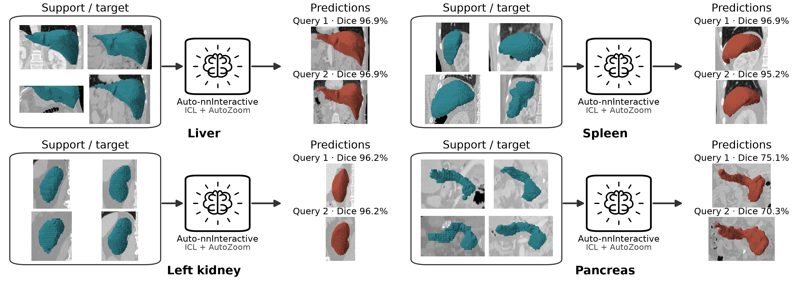
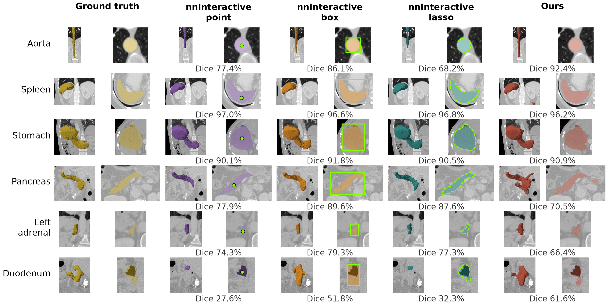

# Auto nnInteractive

**Automatic 3D CT segmentation from annotated examples.**

Auto nnInteractive adapts [nnInteractive](https://github.com/MIC-DKFZ/nnInteractive) to segment a new scan from a small set of annotated support scans. Their masks define the target; the query needs no clicks or boxes. Reuse the same supports across queries without retraining, or supply different masks to request another structure.

| Pretrained model | Training data |
|---|---|
| [TotalSegmentator-ICL.pt](https://drive.google.com/file/d/10e9a8rOpMxN4z3JZes8LlOi5CJUD3grB/view?usp=sharing) | TotalSegmentator CT |



Four support scans and their masks (blue) define each target. Auto nnInteractive predicts masks (red) on new scans. Examples show liver, spleen, left kidney, and pancreas from AbdomenAtlas.

## Installation

Use Python 3.10+ and install PyTorch for your hardware. CUDA is recommended for inference and training.

```bash
git clone https://github.com/aswahd/AutonnInteractive.git
cd AutonnInteractive
python -m venv .venv
source .venv/bin/activate
pip install -e ./client
pip install -e .
```

Install the client first: the client and full package share the `nnInteractive` namespace.

## Download the models

Save the released **TotalSegmentator-ICL.pt** checkpoint linked above to `checkpoints/TotalSegmentator-ICL.pt`. Its architecture and learned support-attention weights are loaded automatically.

The default AutoZoom refinement also uses the frozen [original nnInteractive model](https://huggingface.co/MIC-DKFZ/nnInteractive). Download it with:

```bash
nninteractive-download-model nnInteractive_v1.0 --model-dir checkpoints
```

This creates `checkpoints/models/nnInteractive_v1.0/`. Pass that folder as `original_model_dir` in Python or `--original-model-dir` in the CLI, as shown below.

## Inference on your data

Prepare CT images as `float32` NumPy arrays and support annotations as nonempty binary masks of the same target. Each support mask must align with its image. Scans may have different spatial shapes.

| Input | Shape | Example filename |
|---|---|---|
| Query image | `(1, D, H, W)` | `data/query.npy` |
| Each support image | `(1, d, h, w)` | `data/support_1.npy` |
| Each support mask | `(1, d, h, w)` | `data/support_1_mask.npy` |

For the released CT recipe, use canonical RAS orientation with arrays stored in `(Z, Y, X)` order and 1.5 mm isotropic spacing. Apply the same spatial transforms to each image and its mask, using nearest-neighbor interpolation for masks. Match the training CT normalization: clip HU to `[-1003, 1545]`, then compute `(image + 99.83097076416016) / 502.92486572265625`. Apply this normalization once, before passing images to the session.

The default uses **four supports and one AutoZoom refinement**. Each support receives a foreground-centered 384³ crop, clipped to the available scan and expanded if needed to retain the target, then resized to 192³. The whole query is downsampled to 192³ for prediction; the prediction is restored to the supplied query grid before AutoZoom.

```python
import numpy as np
from nnInteractive.automatic import AutomaticSegmentationSession

session = AutomaticSegmentationSession(
    "checkpoints/TotalSegmentator-ICL.pt",
    device="cuda",
    original_model_dir="checkpoints/models/nnInteractive_v1.0",
)

images, prompts = [], []
mask_channel = session.source["channel_mapping"]["prev_seg"]
for i in range(1, 5):
    image = np.load(f"data/support_{i}.npy")
    mask = np.load(f"data/support_{i}_mask.npy")
    prompt = np.zeros((7, *image.shape[1:]), dtype=np.float32)
    prompt[mask_channel] = mask[0]
    images.append(image)
    prompts.append(prompt)

session.set_context(images, prompts)
result = session.predict(np.load("data/query.npy"))
np.save("segmentation.npy", result.mask)
```

`set_context` prepares the annotated examples that define the target. `predict` segments that target and runs AutoZoom without manual query prompts. The saved mask uses the preprocessed query grid; use your preprocessing transforms to map it back to the original image geometry. Reuse the session and context for additional queries.

The default 384³ support context and whole-query downsampling to 192³ may not be best for your dataset. Try different `support_context` sizes in `set_context`, or construct the session with `full_volume=False` for sliding-window query inference, which may preserve useful detail for small structures. Compare the resulting masks on your own data to choose what works best.

Use `set_context(images, prompts, support_context=None)` for supports already prepared at the model input size. Use `session.predict(query, refinement="none")` to skip AutoZoom.

### Command line

The CLI accepts `supports.npz` with `images` shaped `(K, 1, d, h, w)` and `prompts` shaped `(K, 7, d, h, w)`. Put binary masks in the checkpoint's `prev_seg` channel and zero the other channels, as in the Python example. Use the Python API for support scans with different shapes.

```bash
nninteractive-automatic predict \
  --checkpoint checkpoints/TotalSegmentator-ICL.pt \
  --original-model-dir checkpoints/models/nnInteractive_v1.0 \
  --query data/query.npy \
  --supports supports.npz \
  --output prediction.npz
```

The output archive contains `mask` and the initial prediction as `coarse_mask` and `coarse_probabilities`. Pass `--support-context` to change the support crop size, `--sliding-window` to use the checkpoint's query window size, or `--refinement none` to skip AutoZoom.

## How it works

Multiscale cross-attention transfers information from the annotated supports to the query features of nnInteractive's 3D encoder and decoder. The repository supports hierarchical attention with learned support aggregation, 3D rotary position encoding (RoPE), and interleaved query conditioning. Frozen nnInteractive then refines the automatic prediction through its native AutoZoom engine.

## Segmentation examples



Each example pairs a coronal view with an axial overlay. Green marks indicate the point, box, or lasso supplied to nnInteractive; Auto nnInteractive uses four annotated supports without query prompts. Displayed Dice scores measure full-volume overlap for these examples.

## Training

Start with [hierarchical.json](examples/automatic/hierarchical.json), or use the [TotalSegmentator template](examples/automatic/totalsegmentator_supervoxels.json) to include generated training regions. Set the original model and data paths in your configuration, then run:

```bash
nninteractive-automatic train --config train.json --output runs/model
```

Resume with `--resume runs/model/last.pt`. Architecture changes require a new run. See the [quick start](documentation/automatic.rst) for manifest preparation and the [generated-region guide](documentation/totalsegmentator_supervoxels.md) for additional training masks.

## Documentation

| Resource | Contents |
|---|---|
| [Quick start](documentation/automatic.rst) | Input formats, inference, and training commands |
| [Training configurations](examples/automatic/) | Portable configuration templates |
| [Generated regions](documentation/totalsegmentator_supervoxels.md) | Optional training masks and dataset preparation |

## License

The code is licensed under [Apache-2.0](LICENSE). The original [nnInteractive pretrained weights](https://huggingface.co/MIC-DKFZ/nnInteractive) are licensed under **CC BY-NC-SA 4.0**. Checkpoint licenses are separate from the code license; consult the applicable model terms when using or distributing weights.
